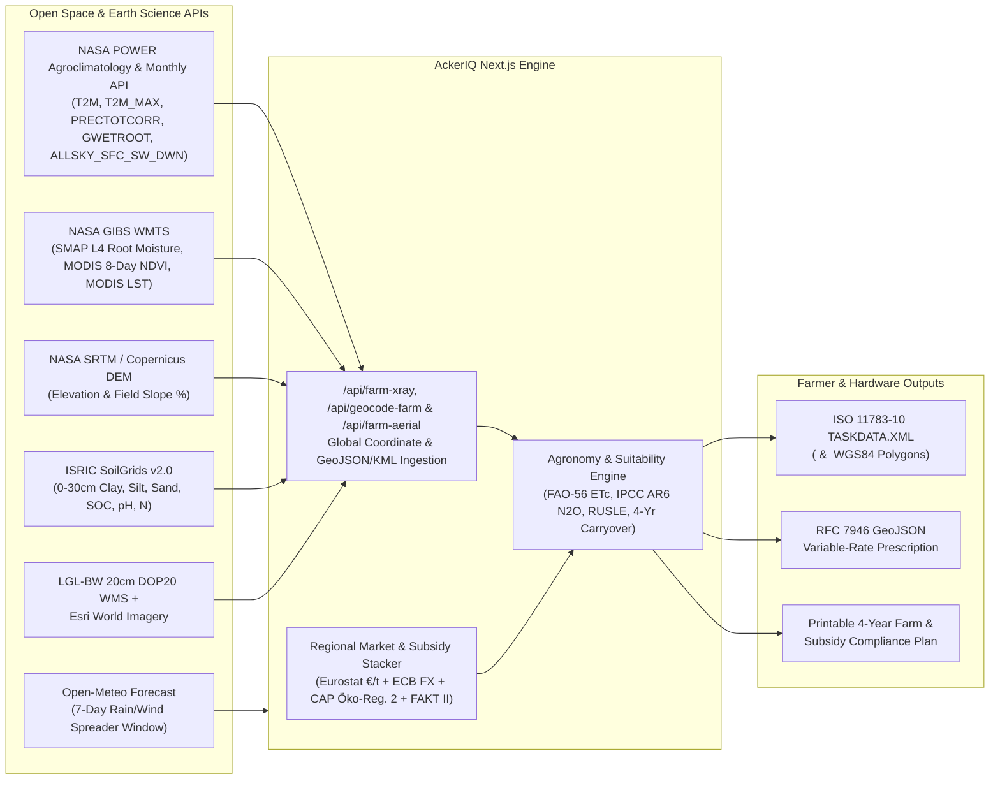

# AckerIQ — Orbital Agronomy & Variable-Rate Crop Rotation Planner

- **Live Production Demo (Google Cloud Run):** https://ackeriq-188358032348.europe-west1.run.app
- **2026 NASA Space Apps Challenge:** [Field Shift: Adapting Farms with NASA Data](https://www.spaceappschallenge.org/2026/challenges/adapting-farms-with-nasa-data/)
- **Source Code Repository:** https://github.com/innovpk/ackeriq
- **Open-Source License:** OSI-approved [MIT License](./LICENSE)

**AckerIQ** closes the gap between coarse Earth-observation telemetry and in-cab farm machinery. By fusing live **NASA POWER agroclimatology & multi-decade climate-shift series**, **NASA SMAP L4 root-zone soil moisture**, **NASA MODIS NDVI & Land Surface Temperature**, **NASA SRTM / Copernicus DEM terrain slope**, **ISRIC SoilGrids v2.0**, and **20 cm orthophoto imagery**, AckerIQ designs 4-year crop rotations, evaluates custom crops against local soil moisture and heat stress, and exports georeferenced **ISO 11783-10 (`TASKDATA.XML`)** and **GeoJSON** variable-rate Nitrogen prescriptions ready for tractor spreader terminals.

---

## 1. Real-World Problem & Quantified Impact

Arable farmers face three converging pressures:
1. **Drought & Peak Summer Heat:** Multi-decade summer warming and falling July root-zone soil moisture (`SMAP L4` & `NASA POWER`) slash spring cereal and maize yields.
2. **Fertilizer Costs & Nitrate Caps (`Rote Gebiete`):** Synthetic mineral Nitrogen (`KAS 27%`) drives farm input costs while winter bare-soil runoff contaminates drinking-water aquifers (>50 mg $\text{NO}_3^-$/L) and emits nitrous oxide ($\text{N}_2\text{O}$, **273×** the 100-year warming potential of $\text{CO}_2$, IPCC AR6).
3. **Actionability Gap:** Satellite portals display raw raster layers (`NDVI`, `SMAP`), not local crop-contract economics (€/t), phytosanitary rotation breaks, CAP/FAKT II eco-scheme eligibility, or tractor-ready prescription files.

For every farm coordinate worldwide or imported `.geojson` / `.kml` field boundary, AckerIQ quantifies:
- **Net 4-Year Farm Margin (€/ha & total €)** using EU Eurostat + regional elevator basis quotes + EU GAP Eco-Scheme 2 & FAKT II cover/legume grants.
- **Mineral Nitrogen Saved (% & €)** via biological $\text{N}_2$ fixation, historical 4-year carryover credits, and winter catch-crop scavenging.
- **Climate Footprint Avoided ($\text{t CO}_2\text{e}$)** combining EU Haber-Bosch synthesis emissions, IPCC Tier-1 direct/indirect $\text{N}_2\text{O}$ flux, and winter cover-crop soil organic carbon sequestration.
- **Groundwater $\text{NO}_3^-\text{-N}$ Leaching Prevented ($\text{kg N}$)**, **FAO-56 Soil Water Retained ($\text{m}^3$)**, and **RUSLE Hillside Topsoil Saved ($\text{t}$)**.

---

## 2. System Architecture



---

## 3. NASA, Partner Open Datasets & Third-Party APIs Cited

Every space-agency and open institutional data source integrated in AckerIQ is listed below with its endpoint, resolution, DOI, and open license:

| Dataset / Service | Parameters & Role | Resolution | Citation, Endpoint & License |
| :--- | :--- | :--- | :--- |
| **NASA POWER** (LaRC Agroclimatology) | `T2M`, `T2M_MAX`, `PRECTOTCORR`, `GWETROOT`, `GWETTOP`, `ALLSKY_SFC_SW_DWN` + `1991–2024` summer climate-shift delta | $0.5^\circ \times 0.625^\circ$ (MERRA-2 / CERES), monthly & climatology | `https://power.larc.nasa.gov/api/temporal/` · DOI: `10.5067/POWER` · NASA Open Data (Public Domain) |
| **NASA SMAP L4** via **NASA GIBS** | `SMAP_L4_Analyzed_Root_Zone_Soil_Moisture` | 9 km EASE-Grid 2.0, latency-safe daily composite | `https://gibs.earthdata.nasa.gov/wmts/epsg3857/best/` · DOI: `10.5067/EVKPQZ4AFC4D` · NASA Open Data |
| **NASA Terra MODIS** via **NASA GIBS** | `MODIS_Terra_NDVI_8Day` (`MOD13Q1`), `MODIS_Terra_Land_Surface_Temp_Day` (`MOD11A1`) | 250 m (8-day Julian DOY) / 1 km (daily LST) | `https://gibs.earthdata.nasa.gov/wmts/epsg3857/best/` · DOI: `10.5067/MODIS/MOD13Q1.061` & `MOD11A1.061` · NASA Open Data |
| **NASA SRTM / Copernicus DEM** | Parcel elevation ($z$) & orthogonal gradient slope (%) | 30 m–90 m DEM | DOI: `10.5067/MEaSUREs/SRTM/SRTMGL1.003` queried via Open-Meteo Elevation API (`CC BY 4.0`) |
| **ISRIC SoilGrids v2.0** | `clay`, `silt`, `sand`, `soc`, `phh2o`, `nitrogen` (0–30 cm) | 250 m global | `https://rest.isric.org/soilgrids/v2.0/properties/query` · Poggio et al. (2021) · `CC BY 4.0` |
| **LGL Baden-Württemberg DOP20 WMS** | `IMAGES_DOP_20_RGB` digital orthophotos | 20 cm aerial imagery (BW) | `https://owsproxy.lgl-bw.de/owsproxy/ows/WMS_LGL-BW_ATKIS_DOP_20_C` · Datenlizenz Deutschland (`dl-de/by-2-0`) |
| **Esri World Imagery & Labels** | Global optical satellite basemap & place boundaries | 0.3 m–1 m global | ArcGIS Online `World_Imagery` & `World_Boundaries_and_Places` (Esri, Maxar, Earthstar Geographics, USDA FSA, USGS) |
| **Open-Meteo Weather Forecast API** | 7-day daily max/min temperature, precipitation, 10 m wind speed for DüV spreader window | Local coordinate forecast | `https://api.open-meteo.com/v1/forecast` · Open-Meteo (`CC BY 4.0`, DWD ICON / ECMWF) |
| **EU Eurostat & LEL Schwäbisch Gmünd** | `apri_ap_crpouta` crop output prices (€/100 kg) + BW regional hub basis benchmarks | National & regional market quotes | `https://ec.europa.eu/eurostat/api/dissemination/statistics/1.0/data/apri_ap_crpouta` · EU Open Data (`CC BY 4.0`) |
| **ECB Reference FX (Frankfurter)** | Live `USD`/`EUR` reference exchange rate | Daily ECB fix | `https://api.frankfurter.dev/v1/latest` · European Central Bank Open Data (MIT) |
| **Komoot Photon & OSM Nominatim** | Forward farm address/coordinate search & reverse locality lookup | Street / parcel level | `https://photon.komoot.io/api` & `https://nominatim.openstreetmap.org` · © OpenStreetMap Contributors (`ODbL 1.0`) |

---

## 4. Scientific Methodology & Equations

All calculations are implemented deterministically in [`src/lib/rotationEngine.ts`](./src/lib/rotationEngine.ts), [`src/lib/cropSuitability.ts`](./src/lib/cropSuitability.ts), and [`src/app/api/farm-xray/route.ts`](./src/app/api/farm-xray/route.ts):

### 4.1 FAO-56 Evapotranspiration & Crop Water Stress ($ET_0$, $ET_c$, $K_y$)
Using NASA POWER surface shortwave solar irradiance (`ALLSKY_SFC_SW_DWN`, converted from $\text{kWh m}^{-2}\text{ d}^{-1}$ to $R_s$ in $\text{MJ m}^{-2}\text{ d}^{-1}$ via $\times 3.6$) and mean air temperature ($T_{\text{mean}}$), growing-season reference evapotranspiration (Apr–Sep) is computed via the Hargreaves–Makkink radiation-temperature formulation:

$$ET_0 = \sum_{m=\text{Apr}}^{\text{Sep}} d_m \cdot 0.0135 \cdot (T_{\text{mean},m} + 17.78) \cdot \frac{R_{s,m}}{2.45}$$

Seasonal crop water demand is $ET_c = K_c \cdot ET_0$, and water-limited yield response follows **FAO Irrigation & Drainage Paper No. 56** (Allen et al., 1998; Doorenbos & Kassam, 1979):

$$\frac{Y_a}{Y_m} = 1 - K_y \left(1 - \frac{ET_a}{ET_c}\right)$$

where $ET_a = \min\left(ET_c,\; P_{\text{eff}} + \text{AWC}_{0\text{–}30\text{cm}} \cdot \theta_{\text{SMAP}} + \Delta W_{\text{mulch}}\right)$.

### 4.2 Greenhouse Gas Balance ($\text{CO}_2\text{e}$ via IPCC 2019 Tier-1 & AR6)
Annual net greenhouse gas intensity ($\text{kg CO}_2\text{e ha}^{-1}\text{ yr}^{-1}$) combines:
- **Upstream Haber-Bosch synthesis (EU KAS 27% benchmark):** $3.48\text{ kg CO}_2\text{e per kg synthetic N}$.
- **Direct & indirect field $\text{N}_2\text{O}$ emissions:** IPCC 2019 Refinement Tier-1 emission factor $EF_1 = 0.01\text{ kg N}_2\text{O-N (kg N)}^{-1}$, converted by $\frac{44}{28}$ molecular mass ratio and **IPCC AR6 $\text{GWP}_{100}(\text{N}_2\text{O}) = 273$** plus indirect volatilization/leaching ($5.65\text{ kg CO}_2\text{e per kg synthetic N}$; $2.14\text{ kg CO}_2\text{e per kg biological residue N}$).
- **Winter cover-crop soil organic carbon (SOC) sequestration:** $-440\text{ kg CO}_2\text{e ha}^{-1}\text{ yr}^{-1}$ when winter catch crops replace bare fallow (Poeplau & Don, 2015).

### 4.3 RUSLE Hillside Erosion & Groundwater $\text{NO}_3^-\text{-N}$ Leaching
- **RUSLE ($A = R \cdot K \cdot LS \cdot C$):** Combines May–Aug erosive rainfall ($R$ from NASA POWER), silt/organic-matter soil erodibility ($K$ from ISRIC SoilGrids), slope steepness ($LS$ from NASA SRTM / Copernicus DEM), and ground-cover factor ($C = 0.055$ under winter mulch vs. up to $0.36$ on bare spring slopes).
- **Winter $\text{NO}_3^-\text{-N}$ Percolation:** Scales residual post-harvest mineral N by Nov–Feb percolation (`PRECTOTCORR`), sand/water-holding drainage susceptibility, and winter catch-crop root N scavenging ($-62\%$).

### 4.4 Georeferenced ISO 11783-10 (`TASKDATA.XML`) & GeoJSON Export
Farmers can click-draw a parcel or upload `.geojson` / `.kml` boundaries ([`src/lib/fieldBoundaryGeo.ts`](./src/lib/fieldBoundaryGeo.ts)). [`TractorPrescriptionModal.tsx`](./src/components/TractorPrescriptionModal.tsx) exports:
- **`TASKDATA.XML` (ISO 11783-10 v4.3):** Closed WGS84 exterior `<PFD><PLN><LSG><PNT>` rings and sub-parcel treatment zones `<TZN>` with DDI `0002` application rates ($\text{mg m}^{-2}$).
- **RFC 7946 `.geojson`:** Polygon features carrying `targetNitrogenKgHa`, `zoneType`, `fao56EtcMm`, and `ipccCo2eKgHa` for QGIS or John Deere Operations Center.

---

## 5. Local Development & Deployment

### Prerequisites
- Node.js `>= 20` and `npm`

### Run Locally
```bash
npm install
npm run dev
```
Open `http://localhost:3000` (or `npm run dev -- --port 3005` if port `3000` is occupied). No proprietary API keys or `.env` secrets are required—all NASA Earthdata (`POWER`, `GIBS`), ISRIC SoilGrids, LGL-BW WMS, Eurostat, and Open-Meteo endpoints run out of the box with graceful regional fallbacks for offline rural connectivity.

### Production Verification & Docker
```bash
npm run lint
npx tsc --noEmit
npm run build
```
A multi-stage [`Dockerfile`](./Dockerfile) (`output: "standalone"`) and [`deploy.sh`](./deploy.sh) script are included for container deployment on Google Cloud Run or any OCI host.

---

## 6. Open-Source Libraries & Visual Media Attribution

All third-party software packages incorporated in AckerIQ are OSI-compliant open source:
- **Next.js 16 & React 19** — MIT License (Vercel, Inc. & Meta Platforms, Inc.)
- **Leaflet 1.9** — BSD-2-Clause License (Volodymyr Agafonkin & contributors)
- **Recharts 3** — MIT License (Recharts Group)
- **Lucide React** — ISC License (Lucide Contributors)
- **Tailwind CSS 4** — MIT License (Tailwind Labs, Inc.)
- **Illustrative Crop & Soil Thumbnails (`public/images/*.jpg`)** — Original hackathon-generated illustrative photography (released under this repository's [MIT License](./LICENSE)); all live parcel maps and satellite views come directly from NASA GIBS WMTS, LGL-BW DOP20 WMS, and Esri World Imagery.

---

## 7. Use of Artificial Intelligence (NASA Space Apps 2026 Disclosure)

In accordance with the **2026 NASA International Space Apps Challenge** transparency rules:
1. **Software Engineering & Research Assistance:** AI coding assistants (Google Antigravity / Gemini) were used during the hackathon window as pair-programming tools to accelerate TypeScript/React component scaffolding, Leaflet/ISOXML formatting utilities, bilingual (`EN`/`DE`) UI copy, and documentation structure.
2. **Illustrative UI Thumbnails:** Static decorative crop, root-cutaway, and farm card thumbnails in `public/images/*.jpg` were synthesized using AI image generation for clean visual legibility.
3. **Scientific Integrity & NASA Branding Compliance:**
   - **Zero restricted NASA logos, insignia, flags, or mission emblems** were used, modified, or generated anywhere in the codebase or media assets.
   - All Earth-observation layers, soil properties, climate-shift anomalies, crop suitability scores, FAO-56 water balances, IPCC AR6 $\text{N}_2\text{O}$ emissions, RUSLE erosion estimates, and ISO 11783-10 tractor prescriptions are computed **100% deterministically** from live public APIs and peer-reviewed equations—never hallucinated by an LLM at runtime.
